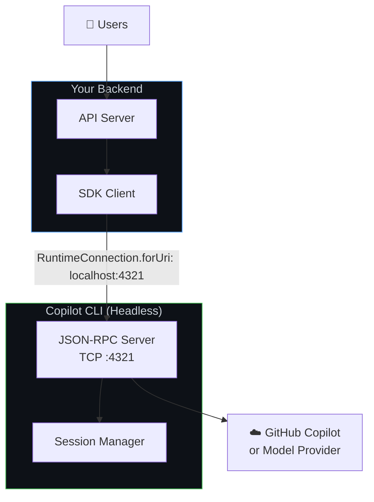
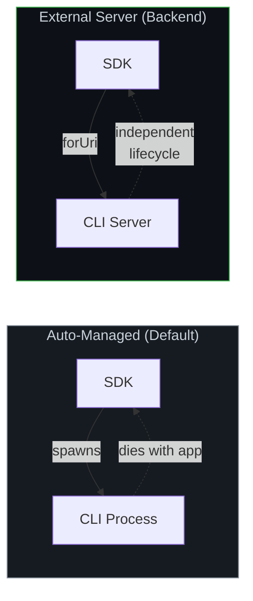
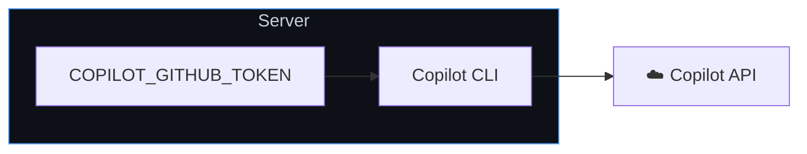
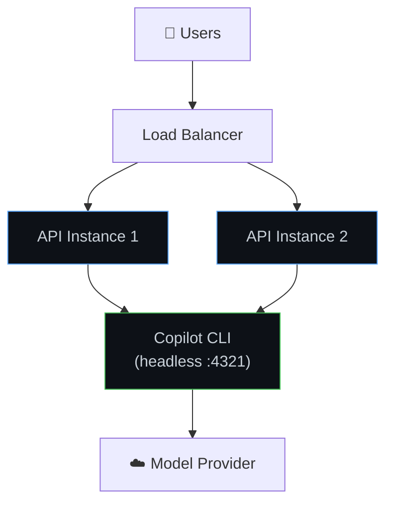
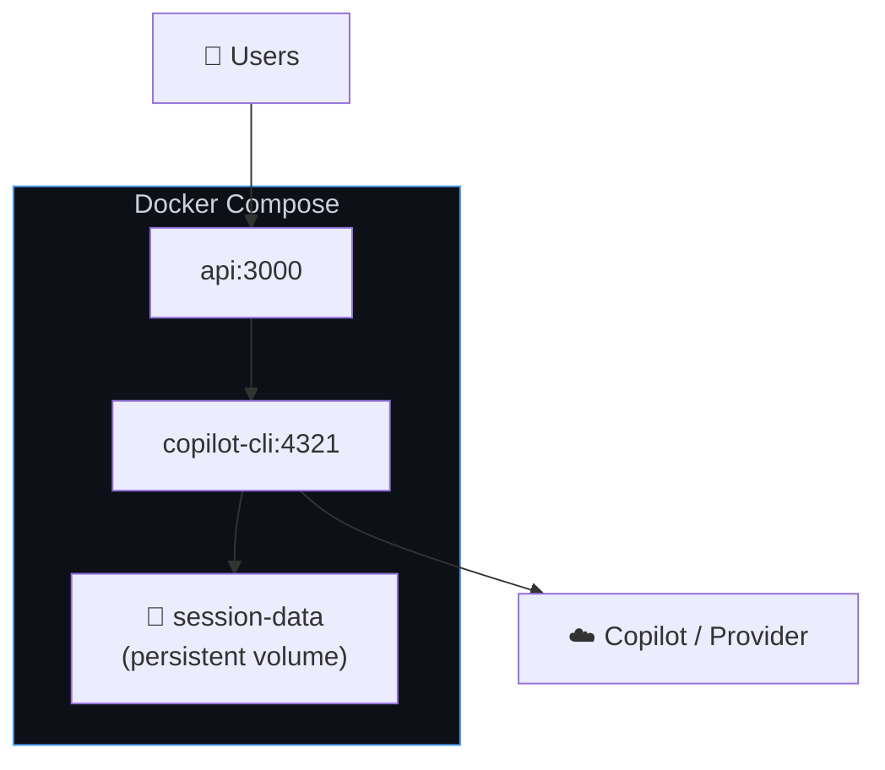

# Backend services setup

Run the SDK in backends, APIs, microservices and workers. Connect to an independent headless CLI over plaintext TCP JSON-RPC. Node.js, Python, Go, .NET and Java reject `https://`; `http://` is only an address alias.

**Best for:** Web app backends, API services, internal tools, CI/CD integrations, any server-side workload.

## How it works

Instead of the SDK spawning a CLI child process, you run the CLI independently in **headless server mode**. Your backend connects to it over TCP using the `Connection` option (`URIConnection`).



**Key characteristics:**
* CLI runs as a persistent server process (not spawned per request)
* SDK connects over TCP—CLI and app can run in different containers
* Multiple SDK clients can share one CLI server
* Works with any auth method (GitHub tokens, env vars, BYOK)

For multi-user server mode, configure SDK clients with `mode: "empty"`, pass user credentials per session, and explicitly allow tools for each session. See [Multi-Tenancy & Server Deployments](./multi-tenancy.md) for the full pattern.

## Architecture: auto-managed vs. external CLI



## Step 1: start the CLI in headless mode

Run the CLI as a background server:

```bash
# Start with a specific port
copilot --headless --port 4321

# Or let it pick a random port (prints the port)
copilot --headless
# Output: CLI server listening on port 52431
```

By default the headless server only accepts connections from loopback (`127.0.0.1`), where it needs no authentication. To accept connections from other hosts—for example from another machine on your network—bind to a non-loopback address with `--host`. A non-loopback bind exposes the full runtime (sessions, shell and file tools, the configured GitHub token) to anything that can reach the port, so the server **requires** a connection token in that case and refuses to start without one. Set `COPILOT_CONNECTION_TOKEN` to a non-empty shared secret on the server, and pass the same value as `connectionToken` from the SDK client:

```bash
# Generate a secret once and keep it (for example in your secret store)
export COPILOT_CONNECTION_TOKEN="$(openssl rand -hex 32)"
copilot --headless --host 0.0.0.0 --port 4321
```

Without `COPILOT_CONNECTION_TOKEN`, a non-loopback bind fails with `refusing to bind the runtime server to non-loopback host ... without a connection token`. Keep the token out of shell history and process arguments, and prefer loopback with an authenticating reverse proxy where you can.

For production, run it as a system service or in a container.

> [!NOTE]
> There is no official pre-built Docker image for the Copilot CLI. You can build your own from the [GitHub releases](https://github.com/github/copilot-cli/releases):

```dockerfile
FROM debian:bookworm-slim
ARG COPILOT_VERSION=1.0.7
RUN apt-get update \
    && apt-get install -y --no-install-recommends ca-certificates wget \
    && ARCH=$(dpkg --print-architecture) \
    && case "${ARCH}" in amd64) COPILOT_ARCH="x64" ;; arm64) COPILOT_ARCH="arm64" ;; *) echo "Unsupported: ${ARCH}" && exit 1 ;; esac \
    && wget -q "https://github.com/github/copilot-cli/releases/download/v${COPILOT_VERSION}/copilot-linux-${COPILOT_ARCH}.tar.gz" \
    && tar -xzf "copilot-linux-${COPILOT_ARCH}.tar.gz" \
    && mv copilot /usr/local/bin/ \
    && rm "copilot-linux-${COPILOT_ARCH}.tar.gz" \
    && apt-get purge -y wget && apt-get autoremove -y && rm -rf /var/lib/apt/lists/*
ENTRYPOINT ["copilot"]
```

```bash
# Build the image
docker build --build-arg COPILOT_VERSION=1.0.7 -t copilot-cli:latest .

# For remote deployments (Kubernetes, ACI, etc.), push to your registry
docker tag copilot-cli:latest your-registry/copilot-cli:latest
docker push your-registry/copilot-cli:latest
```

```bash
# Docker — must bind to 0.0.0.0 so the container's published port is reachable;
# a non-loopback bind requires COPILOT_CONNECTION_TOKEN, forwarded below from the
# value exported above (`-e NAME` with no value keeps it out of the command line).
docker run -d --name copilot-cli \
    -p 4321:4321 \
    -e COPILOT_GITHUB_TOKEN="$TOKEN" \
    -e COPILOT_CONNECTION_TOKEN \
    copilot-cli:latest \
    --headless --host 0.0.0.0 --port 4321

# systemd
[Service]
ExecStart=/usr/local/bin/copilot --headless --port 4321
Environment=COPILOT_GITHUB_TOKEN=your-token
Restart=always
```

## Step 2: connect the SDK

> [!IMPORTANT]
> If you started the server with a non-loopback `--host` (for example the Docker setup above), it requires a connection token. Pass the same `COPILOT_CONNECTION_TOKEN` value to the client as the second argument to `RuntimeConnection.forUri`, for example `RuntimeConnection.forUri("your-host:4321", { connectionToken: process.env.COPILOT_CONNECTION_TOKEN })` (Node), `RuntimeConnection.for_uri("your-host:4321", connection_token=...)` (Python), or the equivalent option in your language. A loopback server (the default `copilot --headless`) needs no token.

<details open>
<summary><strong>Node.js / TypeScript</strong></summary>

<!-- docs-validate: hidden -->
```typescript
import { CopilotClient, RuntimeConnection } from "@github/copilot-sdk";

// Provided by your web framework and auth layer
declare const userId: string;
declare const user: { githubToken: string };
declare const req: { body: { message: string } };
declare const res: { json(body: unknown): void };

const client = new CopilotClient({
    connection: RuntimeConnection.forUri("localhost:4321"),
    mode: "empty",
});

const session = await client.createSession({
    sessionId: `user-${userId}-${Date.now()}`,
    model: "auto",
    availableTools: ["custom:*"],
    gitHubToken: user.githubToken,
});

const response = await session.sendAndWait({ prompt: req.body.message });
res.json({ content: response?.data.content });
```
<!-- /docs-validate: hidden -->
```typescript
import { CopilotClient, RuntimeConnection } from "@github/copilot-sdk";

const client = new CopilotClient({
    connection: RuntimeConnection.forUri("localhost:4321"),
    mode: "empty",
});

const session = await client.createSession({
    sessionId: `user-${userId}-${Date.now()}`,
    model: "auto",
    availableTools: ["custom:*"],
    gitHubToken: user.githubToken,
});

const response = await session.sendAndWait({ prompt: req.body.message });
res.json({ content: response?.data.content });
```

</details>

<details>
<summary><strong>Python</strong></summary>

```python
import time
from copilot import CopilotClient, RuntimeConnection
from copilot.session import PermissionHandler

user_id = "123"
message = "Hello!"

client = CopilotClient(
    connection=RuntimeConnection.for_uri("localhost:4321"),
)
await client.start()

session = await client.create_session(on_permission_request=PermissionHandler.approve_all, model="auto", session_id=f"user-{user_id}-{int(time.time())}")

response = await session.send_and_wait(message)
```

</details>

<details>
<summary><strong>Go</strong></summary>

<!-- docs-validate: hidden -->
```go
package main

import (
	"context"
	"fmt"
	"time"
	copilot "github.com/github/copilot-sdk/go"
)

func main() {
	ctx := context.Background()
	userID := "user1"
	message := "Hello"

    client := copilot.NewClient(&copilot.ClientOptions{
        Connection: copilot.URIConnection{URL: "localhost:4321"},
    })
	client.Start(ctx)
	defer client.Stop()

	session, _ := client.CreateSession(ctx, &copilot.SessionConfig{
		SessionID: fmt.Sprintf("user-%s-%d", userID, time.Now().Unix()),
		Model:     "auto",
	})

	response, _ := session.SendAndWait(ctx, copilot.MessageOptions{Prompt: message})
	_ = response
}
```
<!-- /docs-validate: hidden -->

```go
client := copilot.NewClient(&copilot.ClientOptions{
    Connection: copilot.URIConnection{URL: "localhost:4321"},
})
client.Start(ctx)
defer client.Stop()

session, _ := client.CreateSession(ctx, &copilot.SessionConfig{
    SessionID: fmt.Sprintf("user-%s-%d", userID, time.Now().Unix()),
    Model:     "auto",
})

response, _ := session.SendAndWait(ctx, copilot.MessageOptions{Prompt: message})
```

</details>

<details>
<summary><strong>.NET</strong></summary>

<!-- docs-validate: hidden -->
```csharp
using GitHub.Copilot;

var userId = "user1";
var message = "Hello";

var client = new CopilotClient(new CopilotClientOptions
{
    Connection = RuntimeConnection.ForUri("localhost:4321"),
});

await using var session = await client.CreateSessionAsync(new SessionConfig
{
    SessionId = $"user-{userId}-{DateTimeOffset.UtcNow.ToUnixTimeSeconds()}",
    Model = "auto",
});

var response = await session.SendAndWaitAsync(
    new MessageOptions { Prompt = message });
```
<!-- /docs-validate: hidden -->

```csharp
var client = new CopilotClient(new CopilotClientOptions
{
    Connection = RuntimeConnection.ForUri("localhost:4321"),
});

await using var session = await client.CreateSessionAsync(new SessionConfig
{
    SessionId = $"user-{userId}-{DateTimeOffset.UtcNow.ToUnixTimeSeconds()}",
    Model = "auto",
});

var response = await session.SendAndWaitAsync(
    new MessageOptions { Prompt = message });
```

</details>

<details>
<summary><strong>Java</strong></summary>

```java
import com.github.copilot.CopilotClient;
import com.github.copilot.rpc.*;

var userId = "user1";
var message = "Hello!";

var client = new CopilotClient(new CopilotClientOptions()
    .setCliUrl("localhost:4321")
);

try {
    client.start().get();

    var session = client.createSession(new SessionConfig()
        .setSessionId(String.format("user-%s-%d", userId, System.currentTimeMillis() / 1000))
        .setModel("auto")
        .setOnPermissionRequest(PermissionHandler.APPROVE_ALL)
    ).get();

    var response = session.sendAndWait(new MessageOptions()
        .setPrompt(message)).get();
} finally {
    client.stop().get();
}
```

</details>

## Authentication for backend services

### Environment variable tokens

The simplest approach—set a token on the CLI server:



```bash
# All requests use this token
export COPILOT_GITHUB_TOKEN="gho_service_account_token"
copilot --headless --port 4321
```

### Per-user tokens (OAuth)

Pass individual user tokens when creating sessions. See [GitHub OAuth](./github-oauth.md) for the full flow.

<!-- docs-validate: hidden -->
```typescript
import { CopilotClient, RuntimeConnection } from "@github/copilot-sdk";

// Provided by your web framework and auth layer
interface AuthenticatedRequest {
    user: { id: string; githubToken: string };
    body: { message: string };
}
declare const app: {
    post(
        path: string,
        middleware: unknown,
        handler: (req: AuthenticatedRequest, res: { json(body: unknown): void }) => Promise<void>,
    ): void;
};
declare const authMiddleware: unknown;

const client = new CopilotClient({
    connection: RuntimeConnection.forUri("localhost:4321"),
    mode: "empty",
});

// Your API receives user tokens from your auth layer
app.post("/chat", authMiddleware, async (req, res) => {
    const session = await client.createSession({
        sessionId: `user-${req.user.id}-chat`,
        model: "auto",
        availableTools: ["custom:*"],
        gitHubToken: req.user.githubToken,
    });

    const response = await session.sendAndWait({
        prompt: req.body.message,
    });

    res.json({ content: response?.data.content });
});
```
<!-- /docs-validate: hidden -->
```typescript
const client = new CopilotClient({
    connection: RuntimeConnection.forUri("localhost:4321"),
    mode: "empty",
});

// Your API receives user tokens from your auth layer
app.post("/chat", authMiddleware, async (req, res) => {
    const session = await client.createSession({
        sessionId: `user-${req.user.id}-chat`,
        model: "auto",
        availableTools: ["custom:*"],
        gitHubToken: req.user.githubToken,
    });

    const response = await session.sendAndWait({
        prompt: req.body.message,
    });

    res.json({ content: response?.data.content });
});
```

### BYOK (no GitHub auth)

Use your own API keys for the model provider. See [BYOK](../auth/byok.md) for details.

```typescript
const client = new CopilotClient({
    connection: RuntimeConnection.forUri("localhost:4321"),
});

const session = await client.createSession({
    model: "gpt-5.4",
    provider: {
        type: "openai",
        baseUrl: "https://api.openai.com/v1",
        apiKey: process.env.OPENAI_API_KEY,
    },
});
```

## Common backend patterns

### Web API with Express



Include the helpers from [Session cleanup](#session-cleanup) before accepting requests. On timeout, cancel and drain before disconnecting; retain failed cancellations for explicit recovery.

Your application's `authMiddleware` must set `req.user.id` and `req.user.githubToken` from the authenticated identity. Clients send a per-chat `sessionKey` (or omit it for the default chat), not an SDK session ID. Encode the user ID and key together to keep sessions isolated without ambiguous separators. Reuse the returned `sessionKey` for follow-up requests.

```typescript
import express from "express";
import { CopilotClient, RuntimeConnection } from "@github/copilot-sdk";

const app = express();
app.use(express.json());

// Single shared CLI connection for multi-user server mode
const client = new CopilotClient({
    connection: RuntimeConnection.forUri(process.env.CLI_URL || "localhost:4321"),
    mode: "empty",
});

app.post("/api/chat", authMiddleware, async (req, res) => {
    const { sessionKey = "default", message } = req.body;
    if (typeof sessionKey !== "string" || sessionKey.length === 0) {
        return res.status(400).json({ error: "sessionKey must be a non-empty string" });
    }
    const sessionId = Buffer.from(JSON.stringify([req.user.id, sessionKey])).toString("base64url");

    const response = await withSessionLock(sessionId, async () => {
        let session;
        try {
            session = await client.resumeSession(sessionId, {
                availableTools: ["custom:*"],
                gitHubToken: req.user.githubToken,
            });
        } catch {
            session = await client.createSession({
                sessionId,
                model: "auto",
                availableTools: ["custom:*"],
                gitHubToken: req.user.githubToken,
            });
        }
        let response;
        try {
            response = await session.sendAndWait({ prompt: message });
        } catch (error) {
            try {
                await cancelAndDisconnect(sessionId, session);
            } catch (recoveryError) {
                throw new AggregateError([error, recoveryError], "Session requires recovery");
            }
            throw error;
        }
        await session.disconnect();
        return response;
    });
    res.json({
        sessionKey,
        sessionId,
        content: response?.data.content,
    });
});

app.listen(3000);
```

### Background worker

```typescript
import { CopilotClient, RuntimeConnection } from "@github/copilot-sdk";

// Provided by your application's job queue and result store
interface Job {
    id: string;
    prompt: string;
}
declare function saveResult(jobId: string, content: string | undefined): Promise<void>;

const client = new CopilotClient({
    connection: RuntimeConnection.forUri(process.env.CLI_URL || "localhost:4321"),
});

// Process jobs from a queue
async function processJob(job: Job) {
    const session = await client.createSession({
        sessionId: `job-${job.id}`,
        model: "auto",
    });

    const response = await session.sendAndWait({
        prompt: job.prompt,
    });

    await saveResult(job.id, response?.data.content);
    await session.disconnect();  // Clean up after job completes
}
```

### Docker compose deployment

```yaml
version: "3.8"

services:
  copilot-cli:
    image: copilot-cli:latest  # See "Step 1" above for how to build this image
    command: ["--headless", "--host", "0.0.0.0", "--port", "4321"]
    environment:
      - COPILOT_GITHUB_TOKEN=${COPILOT_GITHUB_TOKEN}
      # Required for a non-loopback bind; the server refuses to start without it.
      - COPILOT_CONNECTION_TOKEN=${COPILOT_CONNECTION_TOKEN}
    ports:
      - "4321:4321"
    restart: always
    volumes:
      - session-data:/root/.copilot/session-state

  api:
    build: .
    environment:
      - CLI_URL=copilot-cli:4321
      # Pass this as `connectionToken` to RuntimeConnection.forUri.
      - COPILOT_CONNECTION_TOKEN=${COPILOT_CONNECTION_TOKEN}
    depends_on:
      - copilot-cli
    ports:
      - "3000:3000"

volumes:
  session-data:
```



## Health checks

Monitor the CLI server's health:

<!-- docs-validate: strict -->
```typescript
// Periodic health check
async function checkCLIHealth(): Promise<boolean> {
    try {
        const status = await client.getStatus();
        return status !== undefined;
    } catch {
        return false;
    }
}
```

## Session cleanup

Lock cleanup, creation, resume, and sends until all work completes. Share locks across processes or clients sharing storage. Failed cancellation blocks reuse, not unrelated cleanup. Call `recoverSession` with the original resume configuration after correcting the cause to reconnect, reacquire ownership, and drain.

<!-- docs-validate: strict -->
```typescript
const sessionLocks = new Map<string, Promise<void>>();
const sessionRecoveries = new Map<string, Awaited<ReturnType<typeof client.resumeSession>>>();

async function withSessionLock<T>(sessionId: string, operation: () => Promise<T>, allowRecovery = false): Promise<T> {
    const previous = sessionLocks.get(sessionId) ?? Promise.resolve();
    let release!: () => void;
    const current = new Promise<void>((resolve) => { release = resolve; });
    const tail = previous.then(() => current);
    sessionLocks.set(sessionId, tail);
    await previous;
    try {
        if (!allowRecovery && sessionRecoveries.has(sessionId)) {
            throw new Error(`Session ${sessionId} requires recovery; call recoverSession before reuse`);
        }
        return await operation();
    } finally {
        release();
        if (sessionLocks.get(sessionId) === tail) sessionLocks.delete(sessionId);
    }
}

async function cancelAndDisconnect(sessionId: string, session: Awaited<ReturnType<typeof client.resumeSession>>) {
    sessionRecoveries.set(sessionId, session);
    const aborted = await session.rpc.abort({});
    if (!aborted.success) throw new Error(aborted.error);
    await session.disconnect();
    sessionRecoveries.delete(sessionId);
}

async function recoverSession(sessionId: string, config: Parameters<typeof client.resumeSession>[1]) {
    await withSessionLock(sessionId, async () => {
        if (!sessionRecoveries.has(sessionId)) throw new Error(`No recovery pending for session ${sessionId}`);
        await client.start();
        const session = await client.resumeSession(sessionId, config);
        await cancelAndDisconnect(sessionId, session);
    }, true);
}

async function cleanupSessions(maxIdleMs: number) {
    const sessions = await client.listSessions();

    for (const session of sessions) {
        if (Date.now() - session.modifiedTime.getTime() <= maxIdleMs) continue;
        await withSessionLock(session.sessionId, async () => {
            if (sessionRecoveries.has(session.sessionId)) return;
            // Recheck freshness while requests for this session are excluded.
            const latest = (await client.listSessions()).find((s) => s.sessionId === session.sessionId);
            if (latest && Date.now() - latest.modifiedTime.getTime() > maxIdleMs) {
                await client.deleteSession(session.sessionId);
            }
        }, true);
    }
}

// Run every hour
setInterval(() => {
    cleanupSessions(24 * 60 * 60 * 1000).catch(console.error);
}, 60 * 60 * 1000);
```

## Limitations

| Limitation | Details |
|------------|---------|
| **Single CLI server = single point of failure** | See [Scaling guide](./scaling.md) for HA patterns |
| **No built-in auth between SDK and CLI** | Secure the network path (same host, VPC, etc.) |
| **Session state on local disk** | Mount persistent storage for container restarts |
| **No idle timeout by default** | Pass `--session-idle-timeout <seconds>` to the CLI server to automatically clean up inactive sessions |

## When to move on

| Need | Next Guide |
|------|-----------|
| Multiple CLI servers / high availability | [Scaling & Multi-Tenancy](./scaling.md) |
| SDK isolation for concurrent users | [Multi-Tenancy & Server Deployments](./multi-tenancy.md) |
| GitHub account auth for users | [GitHub OAuth](./github-oauth.md) |
| Your own model keys | [BYOK](../auth/byok.md) |

## Next steps

* **[Multi-Tenancy & Server Deployments](./multi-tenancy.md)**: Configure SDK isolation for concurrent users
* **[Scaling & Multi-Tenancy](./scaling.md)**: Handle more users, add redundancy
* **[Session Persistence](../features/session-persistence.md)**: Resume sessions across restarts
* **[GitHub OAuth](./github-oauth.md)**: Add user authentication
